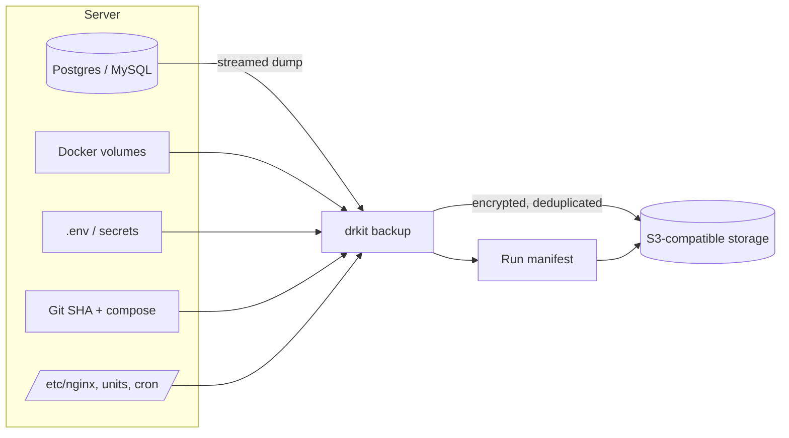
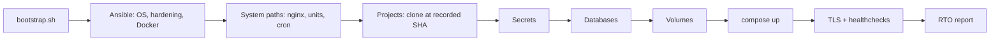

<h1 align="center">drkit</h1>

<p align="center">
  <b>Backup and disaster recovery for Docker Compose servers — databases, volumes, secrets, code and server config — with automated recovery drills.</b>
</p>

<p align="center">
  <a href="https://github.com/caiodassumpcao/drkit/actions/workflows/ci.yml"></a>
  <a href="https://github.com/caiodassumpcao/drkit/actions/workflows/drill.yml"></a>
  
  <a href="LICENSE"></a>
</p>

---

## Why

Most servers have *backups*. Few have *recovery*. A database dump in a bucket doesn't bring back the Nginx config, the `.env` files, the exact commit that was running or the uploaded files — and nobody knows how long a full recovery takes until the day it's needed.

**drkit** treats recovery as the product:

- **One manifest** (`dr.yaml`) describes everything a server needs to come back.
- **Rebuild, don't clone** — system configuration is restored from Infrastructure as Code (Ansible); data comes from encrypted, deduplicated backups.
- **Consistent restore points** — every run records snapshot IDs, git SHAs, image digests and DB versions in a run manifest.
- **Proven, not assumed** — backups are verified by real restores, and a full disaster-recovery drill runs in CI, measuring RPO and RTO.

## Features

| | |
|---|---|
| 🗄️ **Databases** | PostgreSQL and MySQL/MariaDB dumps streamed straight into the repository (no temp files) |
| 📦 **Volumes & files** | Docker volumes (live or stop-consistent), project secrets, selected system paths |
| 🔀 **Project state** | Git remote + exact commit SHA, compose files, pinned image digests |
| 🔐 **Encrypted off-site** | [restic](https://restic.net/) repository on any S3-compatible storage, client-side encryption, deduplication |
| ♻️ **3 restore levels** | `restore db`, `restore project`, `restore host` — with dry-run, resume and step timings |
| ✅ **Verification** | Integrity check + restore of each dump into an ephemeral container |
| 🧪 **DR drill** | Backup → simulated disaster → full recovery → data checksum validation, in CI |
| 🔔 **Alerts** | Telegram and Slack-compatible webhooks |
| 🧾 **Retention** | Daily / weekly / monthly policy, separate prune schedule |

## How it works



Recovering a lost server on a fresh machine:



## Requirements

| Component | Version |
|---|---|
| OS | Ubuntu 22.04 / 24.04 LTS |
| Python | 3.12+ |
| restic | 0.17+ |
| Docker Engine + Compose v2 | 24+ |
| git | any recent |
| Ansible *(host restore only)* | 2.15+ |
| Storage | Any S3-compatible bucket (AWS S3, Backblaze B2, Wasabi, MinIO…) |

## Quick start

```bash
# 1. Install drkit and what it needs (Docker, restic, git, Ansible, certbot); idempotent
curl -fsSL https://raw.githubusercontent.com/caiodassumpcao/drkit/main/scripts/bootstrap.sh | sudo bash

# 2. Credentials (keep a copy OUTSIDE this server — see Security)
sudo install -d -m 700 /etc/drkit
openssl rand -base64 32 | sudo tee /etc/drkit/restic.pass >/dev/null
sudo tee /etc/drkit/env >/dev/null <<'EOF'
AWS_ACCESS_KEY_ID=...
AWS_SECRET_ACCESS_KEY=...
DRKIT_TG_TOKEN=...
EOF
sudo chmod 600 /etc/drkit/*

# 3. Describe your server
sudo curl -fsSL -o /etc/drkit/dr.yaml \
  https://raw.githubusercontent.com/caiodassumpcao/drkit/main/examples/dr.yaml
sudo chmod 600 /etc/drkit/dr.yaml && sudoedit /etc/drkit/dr.yaml

# 4. Check, initialize, back up, prove it restores
sudo drkit doctor
sudo drkit init
sudo drkit backup
sudo drkit verify
```

### Minimal manifest

```yaml
version: 1
host: prod-01

repository:
  url: s3:https://s3.example.com/my-dr-bucket/prod-01
  password_file: /etc/drkit/restic.pass
  env_file: /etc/drkit/env

retention: { daily: 7, weekly: 4, monthly: 6 }

projects:
  - name: shop
    path: /srv/shop
    git: { remote: git@github.com:acme/shop.git }
    compose: { project_name: shop, files: [docker-compose.yml] }
    secrets: [.env]
    databases:
      - { engine: postgres, service: db, database: shop }
    volumes:
      - { name: uploads, consistency: live }
    healthchecks:
      - { url: http://127.0.0.1:8080/health, expect_status: 200 }
```

Full reference: [`docs/configuration.md`](docs/configuration.md) · Annotated example: [`examples/dr.yaml`](examples/dr.yaml)

### Schedule it

```bash
sudo cp examples/systemd/drkit-*.{service,timer} /etc/systemd/system/
sudo systemctl daemon-reload
sudo systemctl enable --now drkit-backup.timer drkit-verify.timer drkit-prune.timer
```

Backups run hourly, verification daily and prune weekly. Logs go to the journal
(`journalctl -u drkit-backup`); add `--json` to any command for machine-readable output.

```bash
sudo drkit runs list            # recent runs and their status
sudo drkit runs show latest     # items, sizes, snapshot IDs, commit, errors
sudo drkit report               # recent runs, current RPO, last verification (Markdown)
```

## Restoring

| Scenario | Command |
|---|---|
| Someone dropped a table | `sudo drkit restore db shop` |
| Bad deploy, corrupted volume, deleted directory | `sudo drkit restore project shop` |
| Server is gone | `bootstrap.sh` on a new server → `sudo drkit restore host` |
| Restore an older point in time | add `--run <run_id>` (see `drkit runs list`) |
| See what would happen first | add `--dry-run` |
| Resume after fixing a failed step | add `--from-step <n> --run <run_id>` (printed on failure) |

Every restore starts from one run manifest, so code, database schema and files belong
together. It prints a numbered plan, asks for confirmation (`--yes` in scripts), times each
step and saves a report in `/var/lib/drkit/reports/`.

- **`restore db`** dumps the current database into a safety snapshot first
  (`kind:pre-restore`, undoable), then restores the run's dump; PostgreSQL restores in a single
  transaction.
- **`restore project`** first backs up what exists of the project (safety snapshots), then
  clones the code at the recorded commit (plus uncommitted changes), puts back compose files
  and secrets (`0600`), pulls the recorded images by digest, restores databases and volumes,
  starts the project, runs `post_restore` hooks and waits for the healthchecks. The previous
  project directory is moved aside, never deleted.

Every restore is announced on the configured notification channels.

For example:

```console
$ sudo drkit restore project shop --yes
Restore shop from run 20261029T030000Z-a1f3 (restore 20261029T101500Z-7c2e)
...
✓ 1. Safety backup of the current project (6.1s): 4 item(s) saved as restore:20261029T101500Z-7c2e: …
✓ 2. Clone the repository at the recorded commit (1.2s): commit 9c1e2b7d5a3f checked out in /srv/shop
✓ 3. Restore compose files and secrets (0.8s): 1 compose file(s), 1 secret file(s) (mode 0600, original owner)
✓ 4. Pull the images (0.9s): 2 service(s) pinned by digest, 0 pulled by tag
✓ 5. Start the database services (7.4s): db ready
✓ 6. Restore the databases (2.1s): shop/db/shop: 12 table(s)
✓ 7. Restore the volumes (1.6s): shop/volume/uploads → shop_uploads
✓ 8. Start the project (3.0s): 3 service(s) started
✓ 9. Run post_restore hooks (4.2s): 1 hook(s) succeeded
✓ 10. Healthchecks (2.5s): http://127.0.0.1:8080/health: HTTP 200 after 2.5s

Restore completed in 29.8s.
```

Step-by-step procedures, including how to undo a restore: [runbook](docs/runbook.md).

### Full server recovery

```bash
# On a fresh Ubuntu server
curl -fsSL https://raw.githubusercontent.com/caiodassumpcao/drkit/main/scripts/bootstrap.sh | sudo bash

# Put dr.yaml, restic.pass and env back in /etc/drkit (from your password manager)
sudo drkit doctor
sudo drkit restore host --dry-run
sudo drkit restore host
```

`restore host` provisions the machine with your Ansible playbook (for example
[server-hardening-kit](https://github.com/caiodassumpcao/server-hardening-kit)), puts back the
system paths marked `restore: true`, restores every project, brings back the TLS certificates
(from the backup, or reissued by certbot), starts nginx and waits for every healthcheck. It
ends with a checklist (DNS records, timers, restored units, packages missing since the backup)
and the measured RTO. CI rehearses it on every pull request: a runner is bootstrapped, backed
up, destroyed and rebuilt.

The step-by-step human procedure — including where the keys come from and the DNS cutover — is
in the [runbook](docs/runbook.md).

## Disaster-recovery drill

Every push to `main` and every week, CI runs a full drill on a disposable runner:

1. Starts a demo stack (PostgreSQL, MySQL, an app writing uploads, Nginx) and seeds data.
2. Runs `drkit backup`.
3. **Destroys everything** — containers, volumes, project directory, Nginx config.
4. Runs `drkit restore host`.
5. Fails unless healthchecks pass and every row count and file checksum matches.

### Measured results

> Published from the CI drill once v1.0 lands.

| Metric | Value |
|---|---|
| RTO (restore start → healthy) | — |
| RPO (drill) | — |
| Data integrity | — |

## Security

- **Client-side encryption** of all data (restic: AES-256 + Poly1305), TLS in transit.
- **Your recovery keys are `restic.pass` + storage credentials.** Store them in a password manager outside the server — without them, backups are unrecoverable.
- Use a storage key scoped to a single bucket, and enable **versioning / object lock** to protect backups from ransomware.
- drkit refuses to run if the manifest or credential files are readable by other users, and redacts secrets from logs and reports.

Found a vulnerability? See [SECURITY.md](SECURITY.md).

## Scope

drkit is built for **Ubuntu servers running Docker Compose projects** with databases as Compose services. It is not a disk-imaging tool — for bare-metal recovery of hand-configured machines, see [ReaR](https://relax-and-recover.org/) or your provider's snapshots.

## Roadmap

- [x] Foundation — CLI, manifest validation, `doctor`
- [x] **v0.1** — Database backup, retention, alerts
- [x] **v0.2** — Volumes, secrets, project state, system paths, verification
- [x] **v0.3** — Database and project restore
- [x] **v0.4** — Full host restore with Ansible
- [ ] **v1.0** — Automated DR drill with measured RPO/RTO

## Documentation

- [Design specification](docs/DESIGN.md)
- [Configuration reference](docs/configuration.md)
- [Recovery runbook](docs/runbook.md)
- [Architecture decision records](docs/adr/)

## Development

```bash
git clone https://github.com/caiodassumpcao/drkit.git && cd drkit
uv sync
uv run pre-commit install
uv run pytest                      # unit tests
uv run pytest -m integration       # needs Docker and restic; volume data needs root
uv run ruff check . && uv run mypy
```

See [CONTRIBUTING.md](CONTRIBUTING.md).

## License

[MIT](LICENSE) © Caio Dassumpção Rodrigues
